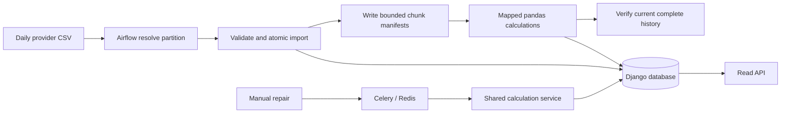

# YCharts Interview Lab: Financial Data Reliability

A focused backend preparation project using **Django, pandas, Airflow and Celery**. A fictional provider delivers daily prices; the pipeline validates revisions, stores audited observations, calculates financial metrics and blocks stale API results. This is an independent demo built around the supplied job description and Terminal.io email.

The email prioritizes a **60-minute Python/string-coding screen and background discussion**. Use the project to explain architectural decisions and practice Django; also rehearse the five manual coding exercises and 2–3 genuine IC stories. This preparation project is not prior professional experience or a description of YCharts' internal systems.

## Start the core demo

Requires [uv](https://docs.astral.sh/uv/getting-started/installation/) and Python 3.12. `uv` can install Python when needed. No API keys, licensed feed or Docker are needed for the basic walkthrough.

```bash
uv sync --locked
uv run python manage.py migrate
uv run python manage.py demo_pipeline
uv run pytest
```

Expected sample: **3 synthetic securities × 29 weekday observations = 87 prices and 87 snapshots**, with 29 accepted batches. Repeat `demo_pipeline` to demonstrate replay safety. The sample dates are September 1–October 9, 2026; prices are fictional, and the weekday calendar ignores exchange holidays.

To inspect the read API, start it explicitly:

```bash
uv run python manage.py runserver 127.0.0.1:8000
```

Open [ALFA metrics](http://127.0.0.1:8000/api/securities/ALFA/metrics/?limit=3) or [batch audits](http://127.0.0.1:8000/api/batches/?limit=3). Responses are JSON. Stop the server with Ctrl+C. Creating or testing this project does not leave servers running.

## Start Airflow

```bash
bash scripts/airflow-local.sh
```

The launcher installs **Airflow 3.1.7 in an isolated environment with its official Python 3.12 constraints** and starts standalone. Open [the Airflow UI](http://127.0.0.1:8080) and use its generated local credentials. Follow [the Airflow guide](docs/airflow.md) to trigger `financial_daily` with:

```json
{"as_of": "2026-10-09"}
```

Unpause the DAG while executing the manual run, then pause it again: the fixture set ends on October 9. Load the full demo history first so its rolling metrics have enough observations. The DAG reuses business services and waits for all mapped calculations before its final quality gate.

The local launcher puts the Airflow environment on `PATH` for child processes. Django initialization does not eagerly import Celery, avoiding the previous macOS worker import issue. Workers initialize the Celery app through the explicit `config.celery:app` entry point.



## Demonstrate a correction and recovery

With the API in a separate terminal:

```bash
uv run python manage.py ingest_prices data/scenarios/correction.csv --date 2026-10-09
curl -i 'http://127.0.0.1:8000/api/securities/ALFA/metrics/?limit=1'
# HTTP 409: data_recalculation_required

uv run python manage.py recalculate --symbols ALFA --as-of 2026-10-09
curl 'http://127.0.0.1:8000/api/securities/ALFA/metrics/?limit=1'
# HTTP 200: current metrics

uv run python manage.py ingest_prices data/scenarios/invalid.csv
# Expected failure: negative adjusted_close; no partial price updates.
```

`data/scenarios/conflict.csv` demonstrates different prices at the same revision when imported before the correction. Older revisions cannot overwrite newer corrections. Exact replay preserves the original batch audit counters and returns `replayed=true`; those counters describe the original accepted batch, not new writes during replay.

## PostgreSQL and asynchronous repairs

Docker Desktop/Engine must be running for the full development stack:

```bash
docker compose up --build -d
docker compose exec web python manage.py demo_pipeline
docker compose exec web python manage.py recalculate --symbols ALFA --as-of 2026-10-09 --async
docker compose logs worker
docker compose down
```

The stack supplies PostgreSQL, Redis, Django, an explicit Celery worker and Airflow. Development ports bind to localhost. PostgreSQL supplies the row-lock behavior needed by concurrent ingestion and calculation; SQLite is a single-writer walkthrough. The sample credentials and Django development server are local demo defaults.

## How the project maps to the role

| Requirement | Demonstration |
| --- | --- |
| Python and Django | Typed models, natural-key constraints, transactions, read API and management commands |
| Airflow | TaskFlow DAG, explicit partitions, retry behavior, mapped chunks and final verification |
| pandas | Independent security windows, mathematical tests, no future observations or warmup filling |
| Celery | Bounded on-demand repair task, retries for transient database errors, safe redelivery |
| Financial data reliability | Decimal stored prices, revision ordering, provenance, rejection audits, stale-result detection |
| Ownership and collaboration | Architecture decisions, acceptance criteria, ticket estimates and IC story prompts |

Four metrics are implemented: fractional daily return, 20-observation SMA, annualized sample volatility over 20 daily returns and running-peak drawdown. All use adjusted close. Decimal preserves stored price precision; statistical outputs use floats. Warmup values remain null.

`as_of` is an observation cutoff. It does not reconstruct which provider revision was known at that historical time. Revisions replace canonical observations; knowledge-time queries require append-only, bitemporal history.

The demo makes no throughput claim for 200,000 securities or 4,000 metrics. It recomputes complete history one security at a time and holds a publication lock. The quality gate checks securities present in the accepted batch; an independently expected universe/calendar is needed to detect provider omissions. [Architecture and scaling trade-offs](docs/architecture.md) explain those boundaries.

## Interview preparation and checks

- [Interview guide: study plan, mock screen, walkthrough and authentic IC stories](docs/interview-guide.md)
- [Implementation tickets, estimates and acceptance criteria](docs/implementation-plan.md)
- [Practice stubs](practice/strings.py) and [separate reference solutions](practice/solutions.py)
- [Verification record](docs/verification.md)

```bash
uv run pytest
uv run ruff check .
uv run python manage.py check
uv run python manage.py makemigrations --check --dry-run
```

Airflow checks require its separate environment; PostgreSQL contention checks require PostgreSQL. Those checks skip in the SQLite-only quick start. The reference string solutions are tested by default. Implement the learner stubs manually, then use the instructions in the interview guide to test your answers. Disable AI assistance during live-interview practice, as requested by Terminal.io.

Core dependencies are locked in `uv.lock`. The GitHub Actions workflow checks PostgreSQL correctness and executes the DAG in a constrained Airflow environment when the project is pushed to GitHub. No remote repository or deployment is created by this setup.
