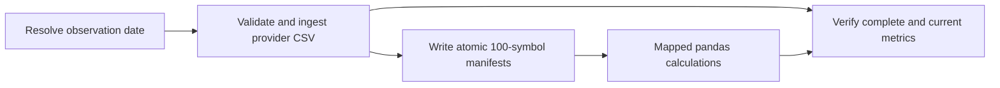

# Airflow walkthrough

Airflow 3.1.7 orchestrates this backend lab. The financial prices are synthetic, and the local demo uses three securities. Airflow is installed separately because its tested dependency constraints differ from the Django application's environment.

## Run the pipeline

```bash
uv sync --locked
uv run python manage.py migrate
uv run python manage.py demo_pipeline
bash scripts/airflow-local.sh
```

Open [Airflow](http://127.0.0.1:8080). The startup script uses a dedicated `.airflow-venv`, configures a four-slot LocalExecutor, and puts that environment on `PATH` so Airflow's child components use the same executable. Use the local admin username and generated password printed in the startup output.

The DAG is named `financial_daily` and begins paused. **Unpause it before triggering it**, then choose **Trigger DAG** and set `as_of` to `2026-10-09`. A paused DAG can accept a manual trigger while leaving the run queued indefinitely. Follow the run in Grid or Graph and expand `calculate_metrics` to inspect its mapped instance. After a successful demonstration, **pause the DAG** again and press Ctrl+C in the Airflow terminal to stop its components.

A successful run follows this graph:



The ingest task returns a path to import metadata. The manifest task returns paths to bounded symbol shards. Prices and pandas frames stay outside XCom. A filesystem path works for LocalExecutor and this shared-volume Docker demo; a distributed executor would use a shared object store and URI references.

## Dates and retries

The DAG uses an explicit `CronDataIntervalTimetable` for `0 23 * * *` in UTC. It processes `data_interval_start.date()`: an interval from October 9 at 23:00 through October 10 at 23:00 imports October 9. This deliberate one-day provider delay is easy to discuss and test. Manual runs must provide a valid `YYYY-MM-DD` `as_of`. Weekends skip because the fixture provider publishes weekdays; production scheduling needs an exchange holiday calendar and provider availability rules.

Tasks have a ten-minute execution timeout and retry transient failures twice with exponential backoff. Provider validation, invalid calculation inputs, and incomplete output raise `AirflowFailException` so deterministic failures stop immediately. A missing provider file can retry while waiting for delivery. Ingestion uses content hashes, provider revisions, and transactions to tolerate replay. Calculation publication records input versions so corrected prices make old metrics stale. The final quality task uses `all_success`, checks the imported securities against required metric definitions, and raises if anything is missing or stale. Its success cannot hide a failed calculation.

Only one DAG run may be active at a time and at most four tasks may run concurrently. The launcher raises Airflow’s mapping limit to 4,096; at 100 securities per shard, 200,000 securities would require 2,000 mapped tasks. These settings bound resource use; they do not demonstrate throughput for 200,000 securities. The ingestion row cap, manifest mapping count, database indexes, process memory, and provider sharding would need measurement and redesign at that scale.

## Docker stack

```bash
docker compose up --build
```

This starts PostgreSQL 16 for financial records, Redis for Celery, Django at [port 8000](http://127.0.0.1:8000/health/), an explicit `config.celery:app` worker, and Airflow at [port 8080](http://127.0.0.1:8080). The web service runs migrations and seeds the demo before the worker and Airflow begin. Airflow's metadata uses a separate local SQLite volume in this development stack. Application tables use PostgreSQL, which supports the row locks required by concurrent imports and repairs.

Compose exposes the HTTP ports only on localhost. Its database password is a local development setting. Airflow uses its generated local admin credentials. Stop the stack without deleting its data with:

```bash
docker compose down
```

## Test the actual framework

The normal Django test suite skips DAG tests when Airflow is absent. Run them with the isolated environment:

```bash
uv pip install --python .airflow-venv/bin/python 'pytest>=8,<9' 'pytest-django>=4.9,<5' \
  --constraint https://raw.githubusercontent.com/apache/airflow/constraints-3.1.7/constraints-3.12.txt
.airflow-venv/bin/python -m pytest tests/test_dag.py
```

These tests import the real SDK and assert dependencies, retry policy, scheduling intervals, strict manual dates, weekend skips, bounded manifest mapping, atomic file replacement, and lazy application initialization. For an actual task execution against the seeded local database, the CLI also supports:

```bash
bash scripts/airflow-local.sh db migrate
bash scripts/airflow-local.sh dags test financial_daily \
  2026-10-09T23:00:00+00:00 --conf '{"as_of":"2026-10-09"}'
```

CLI testing executes tasks but does not verify the standalone scheduler. A full demonstration should also trigger one run through the running scheduler and verify its terminal state and task logs.

Official references: [Airflow 3.1.7 quick start](https://airflow.apache.org/docs/apache-airflow/3.1.7/start.html), [dynamic task mapping](https://airflow.apache.org/docs/apache-airflow/3.1.7/authoring-and-scheduling/dynamic-task-mapping.html), and [Docker setup](https://airflow.apache.org/docs/apache-airflow/3.1.7/howto/docker-compose/index.html).
