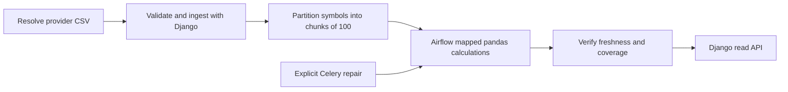

# Architecture and data contracts

This interview project models a small financial-price pipeline: ingest a provider file, validate it, persist revisions, calculate metrics, and publish only results that match the current source data. Airflow owns scheduled orchestration; Django owns the domain rules and database; pandas performs calculations; Celery supports explicit repair jobs.

It is an independent practice project based on the supplied job description and recruiter email. The synthetic demo is not connected to YCharts or a market-data provider. Three fictional USD securities and 29 weekday observations, from September 1 through October 9, 2026, make it possible to inspect every stage. These are generated weekdays, not an exchange trading calendar: holidays and exchange sessions are not modeled. This dataset is not a benchmark for 200,000 securities or 4,000 metrics.

## Pipeline

Airflow carries file paths, batch identifiers, dates, and symbol chunks in XCom. The complete CSV and DataFrames stay outside XCom. The final verification task joins the mapped calculations and checks the imported securities. A successful task execution alone is insufficient evidence that the published metrics are current.

Airflow and Celery call the same Django service layer. Airflow runs a scheduled dependency graph; Celery runs an explicitly requested asynchronous recalculation. The DAG does not enqueue Celery work and immediately call that completed. Such a design would need a completion sensor and separate error propagation.

The Airflow partition date represents the requested observation cutoff, passed through to calculation and verification. Calculation reads a security's complete observed history through that cutoff so a one-day import can still produce rolling metrics. It does not calculate a rolling average from just the current import file.

## Storage model

| Model | Important fields and constraints | Purpose |
| --- | --- | --- |
| `Security` | Unique `symbol`, `currency`, monotonically increasing `data_version` | Stable identity and freshness version for a security's source history. |
| `PriceBar` | Security/date unique key; `Decimal` close and adjusted close; volume; positive provider revision; source batch | Canonical, validated provider observation. Decimal storage avoids binary floating-point rounding in imported prices. |
| `ImportBatch` | SHA digest, partition date, state, errors, counters, imported symbols | Auditable import attempt, replay identity, and orchestration handoff. |
| `MetricSnapshot` | Security/date unique key; metric values; `source_version`; `calculation_version` | Materialized calculations with explicit input and formula versions. |

Raw prices are stored as decimals; pandas calculations and API metric values use floating point. This is appropriate for an analytics demo with tested numerical tolerances. Accounting-grade cash ledgers would require a separate precision and rounding contract.

`calculation_version` is `v1` for the current formulas. A future formula change must bump that version and rebuild or reject older snapshots, even if source prices have not changed. `data_version` changes only when a security's canonical observations change, not merely because a file is replayed.

## Atomic import and revision rules

The CSV schema is exactly `symbol,date,close,adjusted_close,volume,provider_revision`, with one observation date per file. Currency is fixed to USD for the demo and is not a CSV field. Validate the entire CSV before updating canonical observations. Reject malformed fields, unknown schema, invalid dates, nonpositive prices, negative volumes, nonpositive revisions, or any duplicate security/date observations inside a file. If any row fails, no canonical source row is partially updated. The batch audit can still preserve a failure and its diagnostic reason.

For an existing security/date, compare incoming and stored provider revisions:

| Incoming revision | Incoming value | Result |
| --- | --- | --- |
| Lower | Any otherwise valid value | Ignore the outdated row. |
| Equal | Same normalized values | No operation; replay is safe. |
| Equal | Different normalized values | Reject the file as a conflicting revision. |
| Higher | Valid new values | Accept the correction and invalidate the security's metric freshness. |

New observations also change the security's source version. A higher provider revision is a change even if the prices happen to match: provenance has advanced. A conflicting row cannot be resolved by guessing which file arrived last. Provider revision, rather than arrival order, supplies the ordering contract.

File SHA is useful for replay auditing, but row-level revision checks remain necessary. Different file bytes may describe identical data, and a file may mix new rows, safe replays, and outdated rows. Preserve counts that explain those outcomes rather than reporting every parsed row as an insertion.

Updating `data_version` conservatively invalidates previously calculated snapshots for that security. This is deliberately simple: a correction after an earlier requested cutoff can still require recalculation under the global version scheme. A more selective dependency version would reduce unnecessary work at the cost of a more complex correctness model.

## Consistency and concurrency

In PostgreSQL, ingest, calculation, final verification, and API publication take locks on the affected `Security` rows in sorted order. All participating code paths use the same order, reducing deadlock risk. Locks make freshness checks meaningful: source observations cannot change between checking a version and publishing the associated metrics.

For the small demo, calculation holds the security lock while reading history, computing, and writing its snapshots. This favors a clear correctness contract over throughput. In production, long computations could read a stable version, compute outside the lock, and acquire a short publication lock to compare the source version; a mismatch would discard and retry the result.

SQLite is convenient for a local, single-writer demo. SQLite does not provide the same row-lock behavior as PostgreSQL. Use PostgreSQL when demonstrating concurrent ingestion and calculation; do not infer production concurrency guarantees from SQLite tests.

Celery is configured through an explicit module/worker entry point. Avoid importing the Celery app as a side effect of initializing the Django project package. This also avoids unnecessary imports and platform-specific interactions when local Airflow processes start on macOS.

## Metric definitions

All metrics below use adjusted close observations ordered by date. The dataset assumes USD and one observation per generated weekday. There is no currency conversion, dividend modeling beyond the supplied adjusted-close value, or inferred price for a missing date.

| Metric | Formula and availability |
| --- | --- |
| One-day return | `P[t] / P[t-1] - 1`; the first observation has no return. Here “day” means the previous available observation. |
| SMA 20 | Mean of the current and preceding 19 observed adjusted closes; unavailable until 20 observations exist. |
| Annualized volatility 20 | Sample standard deviation (`ddof=1`) of 20 observed daily returns, multiplied by `sqrt(252)`; requires 21 prices. |
| Drawdown | `P[t] / max(P[0:t]) - 1`, using the running peak from the start of observed history through the current date. |

`252` is a modeling convention used to annualize daily-return dispersion. It is not a guarantee about exchange sessions in this synthetic dataset. Missing rolling-window values remain unavailable rather than becoming zero. Nonfinite pandas values must be converted to JSON-safe null values.

Metrics are calculated over complete history through `as_of`. The API `limit` bounds the most recent results and the corresponding observed-date coverage check; it does not shrink the history used in calculations. The API checks the requested slice, while Airflow's final quality gate checks the full observed history for the imported securities.

## Read API contract

| Endpoint | Behavior |
| --- | --- |
| `/health/` | Local application health check. |
| `/api/securities/` | Inspect the fictional security universe and source versions. |
| `/api/securities/<symbol>/metrics/?as_of=2026-10-09&limit=3` | Return the latest snapshots through the cutoff only when their dates match the latest observed price dates in the requested slice and their versions are current. |
| `/api/batches/` | Inspect batch state and ingestion counters. |

Malformed query parameters return `400`. `limit` defaults to 30 and must be between 1 and 100. An unknown security returns `404` with `unknown_security`; no available metric snapshots through the requested cutoff returns `404` with `metrics_not_available`. Otherwise, compare the returned snapshot dates with the latest observed price dates through the cutoff, bounded by the same limit. A date mismatch, old source version, or old calculation version returns `409` with `data_recalculation_required`. A missing rolling metric due to its documented warm-up window is valid null data, not a missing snapshot.

The `409` is intentional: a corrected provider price can make an old metric look plausible while making it wrong. Recalculation restores publication. Do not silently return old results as if they were current.

`as_of` is an observation-date cutoff, not a bitemporal “what did we know on that day?” query. A provider correction received later can change a historical answer after recalculation. Supporting historical knowledge requires storing observation versions and their arrival/effective times, then selecting the versions known at a particular time.

## What verification can and cannot establish

Airflow's final verification checks every observed source date through the cutoff for the securities handed off by ingestion. It detects missing snapshots and outdated source/formula versions, including missing dates outside a requested API slice. Each API request checks only the latest observed dates within its limit; it does not scan full history. The global source version still makes any produced snapshot from before a correction stale, regardless of which source date was corrected.

It cannot detect a provider file that silently omits an expected security or exchange session without a separately defined expected-universe manifest and market calendar. A production design should compare the delivered manifest with expectations and distinguish an absent price, exchange holiday, suspension, late file, and explicitly empty provider response. This demo makes no broader completeness claim.

Other production extensions include object storage for immutable files, provider reconciliation, retention rules, metric dependency tracking, per-provider operational SLOs, database partitioning, bulk-write tuning, and observability for queue age, freshness lag, rejected rows, retries, and correction volume. Their exact designs should follow measured workload and product requirements.
